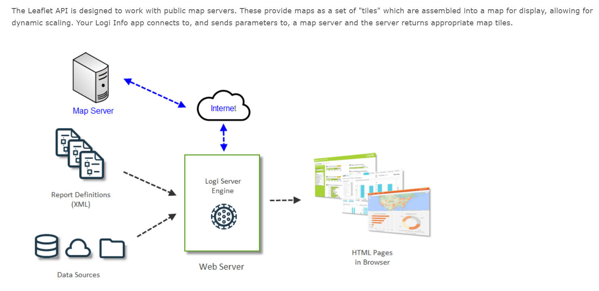

# SoilViews

React 19 + Vite single-page app for ordering and viewing satellite-derived soil/crop data on a Leaflet map. Backend: Firebase (Auth, Firestore, Storage, Cloud Functions). UI languages: en/bg.

## Requirements

- Node.js >= 20 (Node 22 recommended)

## Setup

1. `npm install`
2. Copy `.env.example` to `.env.local` and fill in the Firebase web config (`VITE_FIREBASE_*`). `VITE_EMAIL_SERVER_URL` is the URL of the email server (default `http://127.0.0.1:4000`). `.env.local` is git-ignored.
3. `npm run dev` - dev server on [http://localhost:3000](http://localhost:3000)

## Scripts

- `npm run dev` / `npm start` - Vite dev server (port 3000)
- `npm run build` - production build into `build/` (served by Firebase Hosting)
- `npm run preview` - serve the production build locally
- `npm test` - run Vitest once; `npm run test:watch` for watch mode; single file: `npx vitest run path/to/file.test.jsx`

## Email server

A separate Express + Sendgrid server (`src/components/server/`, own `package.json`).

1. `cd src/components/server && npm install`
2. Export `SENDGRID_API_KEY` in your shell (never commit it).
3. From the repo root: `npm run server` (or `cd src/components/server && node server.js`)

Open [http://localhost:4000](http://localhost:4000); you should see "Welcome to the Sendgrid Emailing Server".

## Cloud Functions

Live in `functions/` (own `package.json`, Node 20, `firebase-functions` v6 using the v1 API). Run `npm install` there before deploying.

## How to deploy

1. `npm run build`
2. `firebase deploy`

Deploy URL: app.soilviews.com. About the project: soilviews.com

## Docker

1. `npm run docker:build` (or `docker build -t soilviews:1.0 .`)
2. `npm run docker:run` (or `docker run -d -p 3000:3000 -e TZ=Europe/Sofia --name soilviews soilviews:1.0`)

The container runs the Vite dev server on port 3000. Pass Firebase `VITE_*` variables with `-e` or build with a `.env.local` present.

## Architecture

